# Evidencia visual 2C.1

Capturas automáticas de la aplicación real con datos ficticios. No se reimporta la Biblioteca de la sesión del usuario.

## celular lan

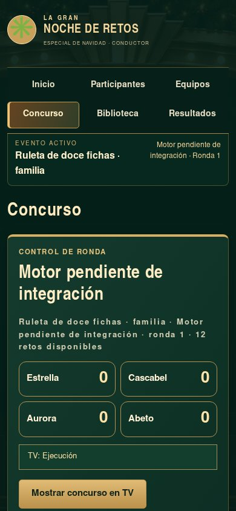

## celular motor pendiente

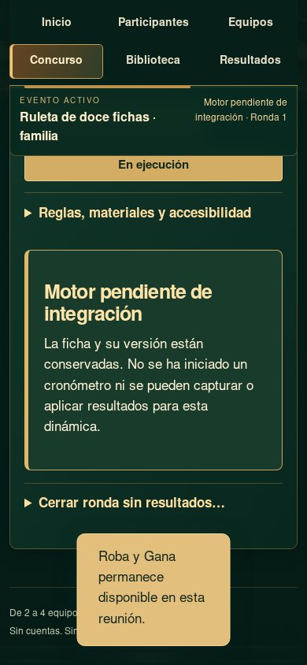

## celular ruleta

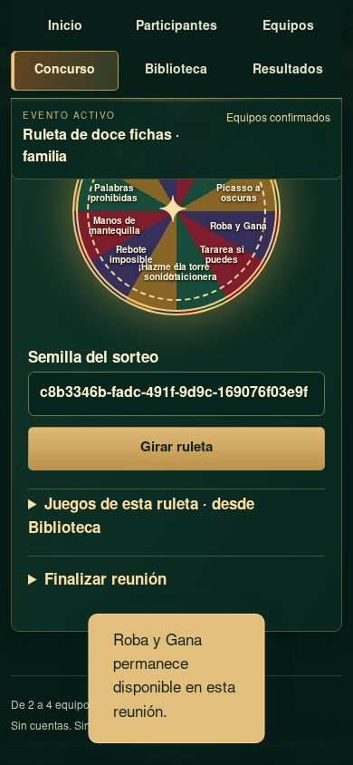

## conductor cronometro

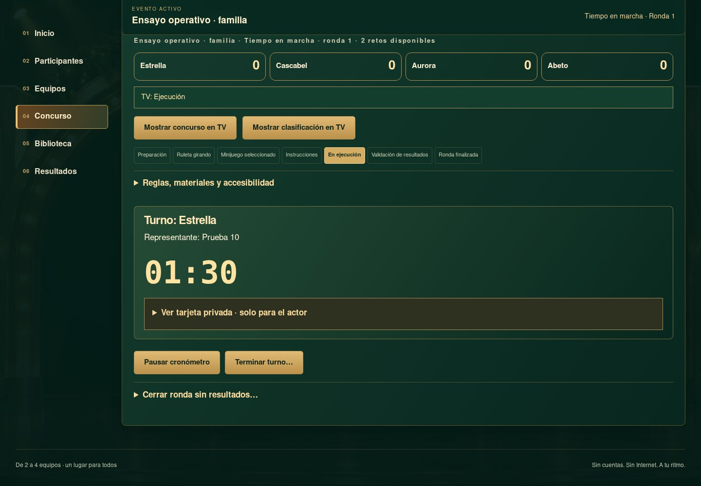

## conductor motor pendiente

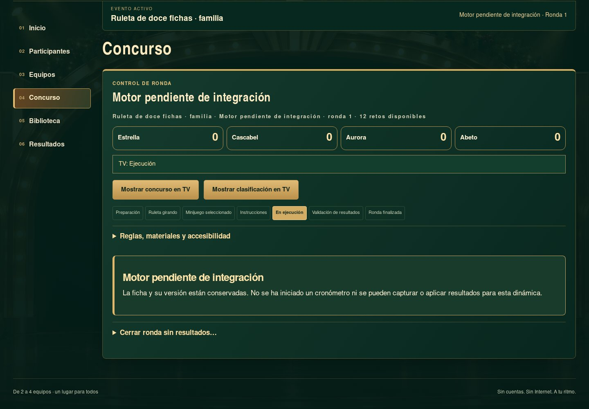

## conductor preparacion

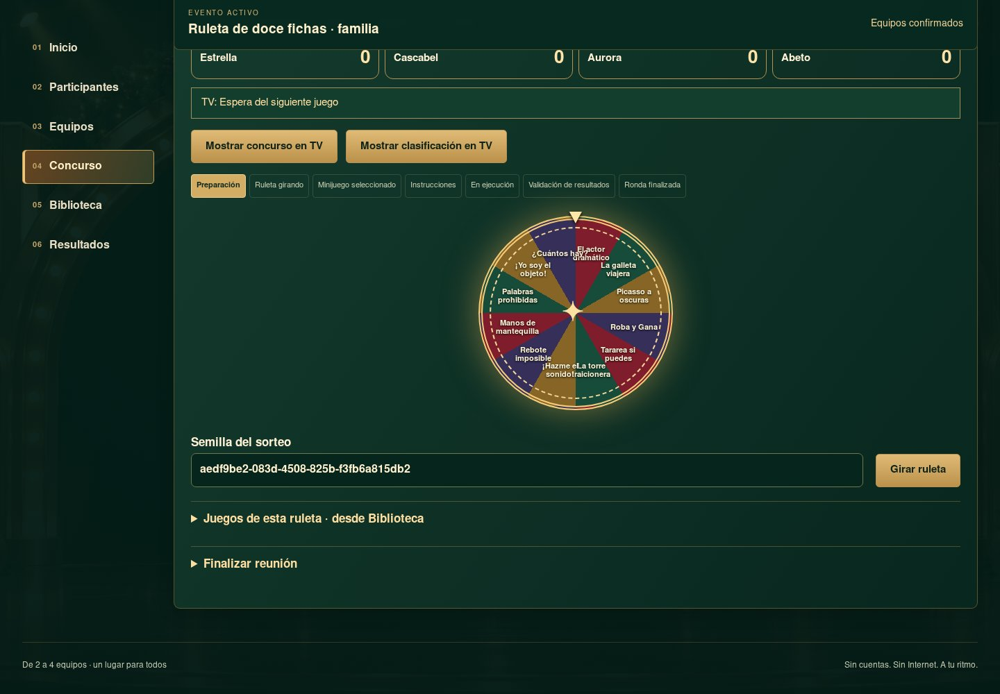

## conductor seleccionado

## tv cierre sin puntos

## tv clasificacion

## tv cronometro

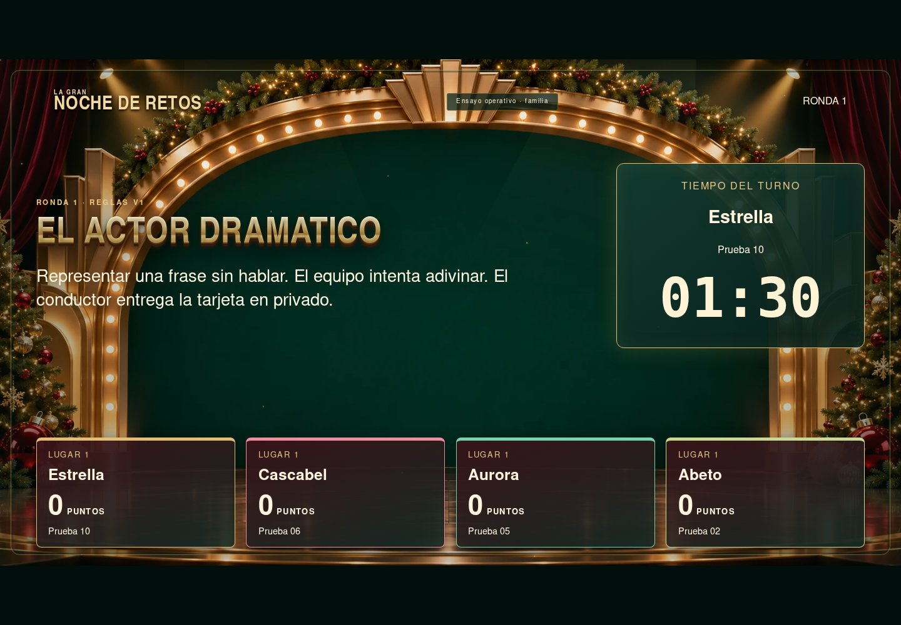

## tv espera

## tv instrucciones

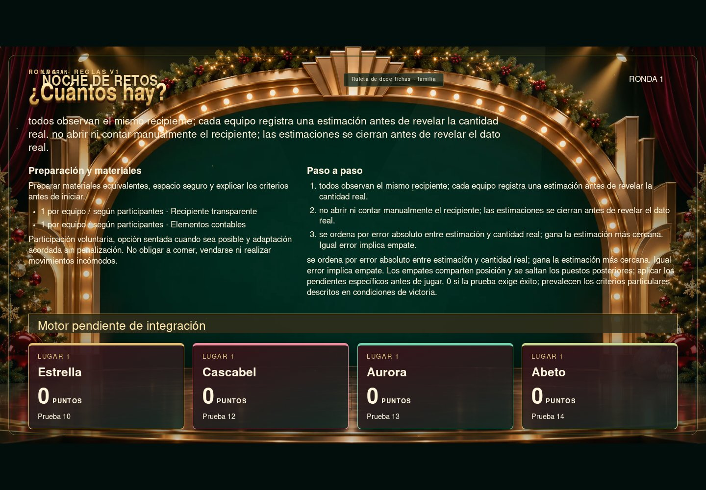

## tv lan

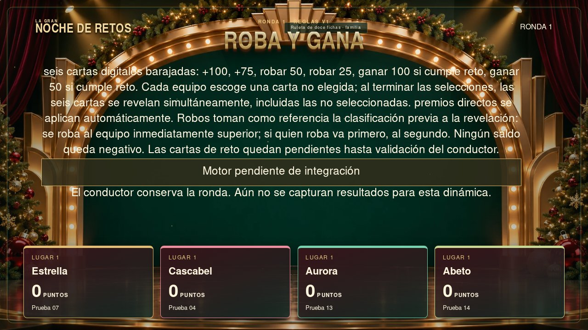

## tv motor pendiente

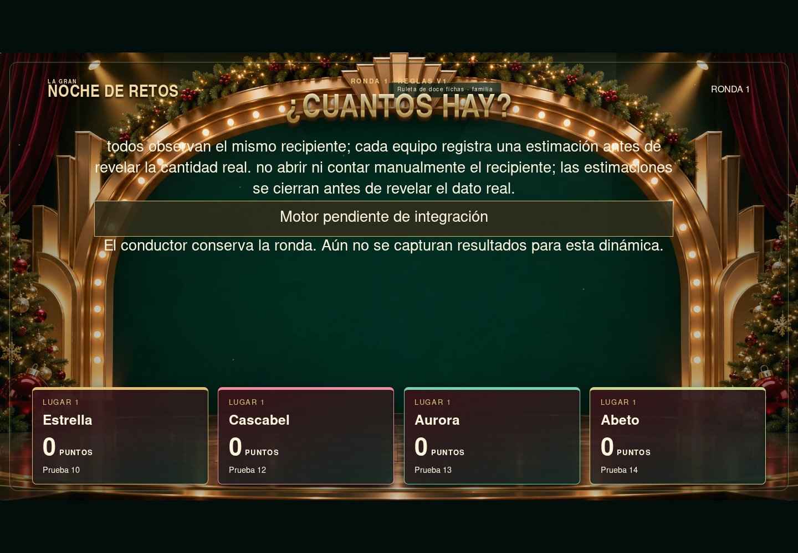

## tv resultados

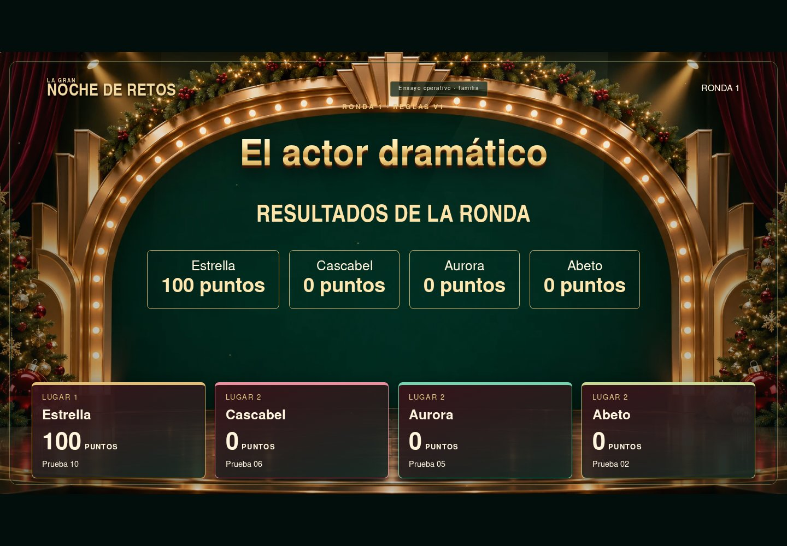

## tv ruleta

## tv seleccionado

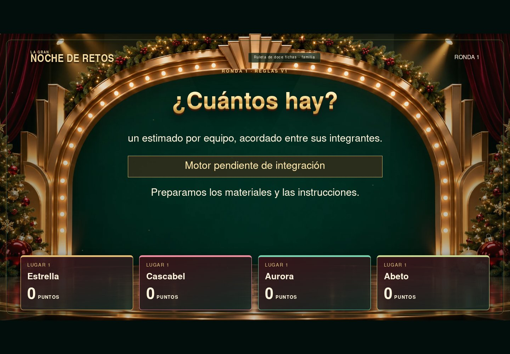
